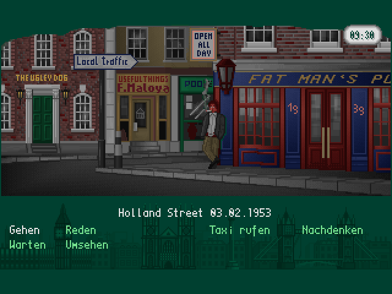
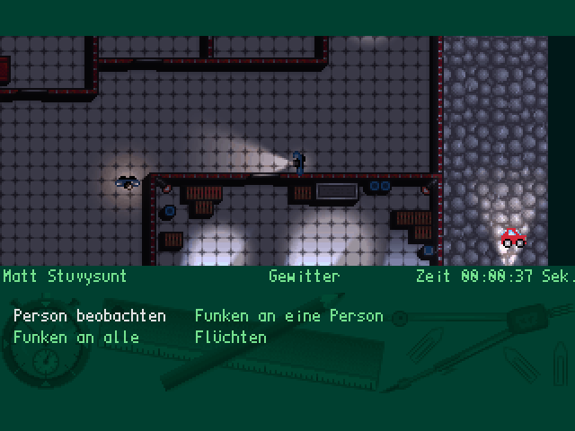
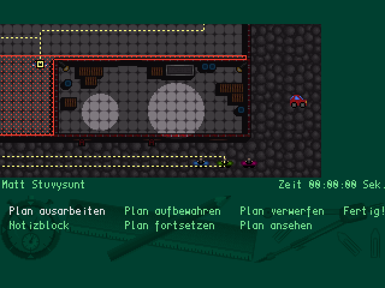
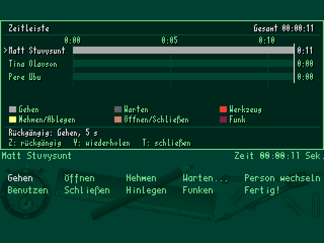
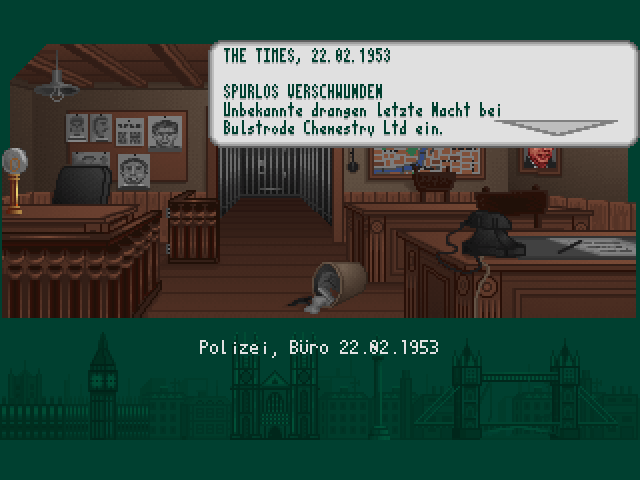
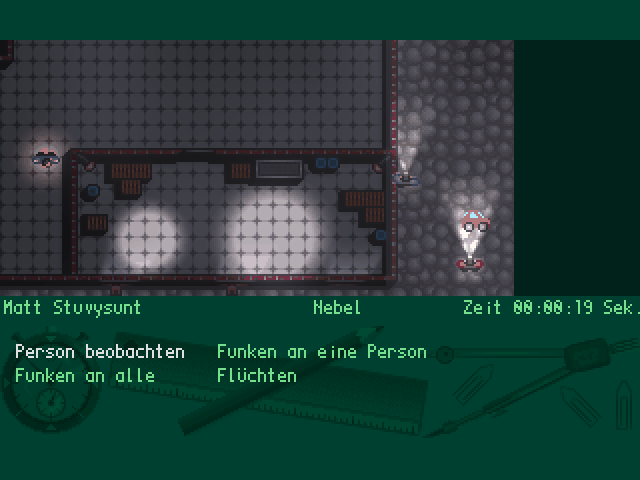

# Der Clou! remastered

Die Einbruchssimulation **Der Clou!** von 1994 für heutige Rechner und den Browser, wahlweise wie
damals oder mit neuen Ideen.
Basierend auf der Originalversion von neo Software. Details darüber finden Sie unter www.neo.at.

**[Direkt im Browser spielen](https://darksoon.github.io/Der-Clou-remasterd/play/)** (auch auf Handy und Tablet)
· **[Downloads für Windows, Linux und macOS](https://github.com/darksoon/Der-Clou-remasterd/releases/latest)**
· [Änderungen](CHANGELOG.md) · [Roadmap](ROADMAP.md)

| | |
| --- | --- |
|  |  |
| London, 1953: Matt Stuvysunt sucht Komplizen, Werkzeug und ein lohnendes Ziel | Spiel+: Einbruch bei Nacht mit Taschenlampen, Mondlicht und Gewitter |
|  |  |
| Spiel+: Laufwege und Sichtbereiche der Wachen in der Planung | Spiel+: Zeitleiste aller Einbrecher mit Rückgängig |
|  |  |
| Spiel+: Am Morgen danach steht der Coup in der Zeitung | Spiel+: Nebel verkürzt das Licht |

## Zwei Spielarten

Beim Start eines neuen Spiels wählt man, wie gespielt wird. Die Wahl steht im Spielstand.

**Original** spielt sich wie 1994: gleiche Regeln, gleiche Werte, gleiche Abläufe. Eine Testpartie mit
Referenzwerten prüft das bei jeder Änderung. Dazu kommen nur Dinge, die am Spiel nichts ändern:

- Läuft unter Windows, Linux, macOS und im Browser, erkennt Standard- und Profidisk, Diskette und CD-ROM
- Sprachausgabe der CD-Version, Musik über eine genaue AdLib-Emulation (Nuked OPL3)
- Fenster frei skalierbar, Vollbild, Bildfilter „Scanlines“ und „Röhrenmonitor“
- Planung per Mausklick: Rechtsklick im Gehen-Modus, die Person nimmt den schnellsten Weg
- Zeitraffer beim Einbruch (Tab), Polizei-Countdown nach einem lauten Alarm
- Tastenwiederholung wie auf der PC-Tastatur von damals, Gamepad, Intro abschaltbar
- Im Browser: Bedienfeld für Touch, als Web-App installierbar, Spielstände als Datei sichern

**Spiel+** baut darauf auf und darf das Spiel verändern:

- Schwierigkeitsgrad leicht, normal oder schwer
- Neue Stimmen für die Geschichte und Hintergrundgeräusche je nach Ort
- Planung mit Laufwegen und Sichtbereichen der Wachen (Taste W) und Zeitleiste mit Rückgängig (Taste T)
- Werkzeuge zeigen, wer aus der Bande damit umgehen kann
- Einbruch bei Nacht und Wetter: klar, bewölkt, Regen, Gewitter oder Nebel, nur Bild und Ton
- Zeitung am Morgen nach dem Coup, automatisches Speichern vor jedem Einbruch
- Werte, Wetter und Schlagzeilen stehen in Lua-Skripten unter `PLUS/` und lassen sich anpassen

## Einstellungen und Tasten

Fast alles lässt sich im Hauptmenü unter „Einstellungen“ ändern. Klick oder Eingabetaste schaltet weiter,
die Pfeiltasten links und rechts verringern oder erhöhen, Rechtsklick oder Escape führt zurück. Alle
Optionen stehen kommentiert in `gamedata/cosp.cfg`.

| Taste | Funktion |
| --- | --- |
| F11 oder Alt+Enter | Vollbild ein und aus |
| F12 | Screenshot als PNG |
| Rechtsklick (Planung, Gehen) | Person läuft auf dem schnellsten Weg zum angeklickten Punkt |
| Tab (Einbruch) | Zeitraffer ein und aus |
| W (Planung, Spiel+) | Laufwege und Sichtbereiche der Wachen ein und aus |
| T (Planungsmenüs, Spiel+) | Zeitleiste; dort Z oder Rücktaste rückgängig, Y wiederherstellen |

Spielstände, Pläne, Screenshots, `settings.cfg` und `clou.log` liegen unter Linux in
`~/.local/share/DerClou/`, unter Windows in `%APPDATA%\DerClou\` und unter macOS in
`~/Library/Application Support/DerClou/`.

## Mods

Eine Datei unter `MODFILES/` im Spielordner wird statt der gleichnamigen Originaldatei geladen, zum
Beispiel `MODFILES/PICTURES/MENU` statt `PICTURES/MENU` oder `MODFILES/PLUS/WEATHER.LUA` für eigene
Wetterchancen. Die Originaldaten bleiben unberührt. Bilder dürfen PNG mit 256-Farben-Palette sein.
Gebäude, Wachenrouten und die Datenbank lassen sich mit `tools/clou-data.py` als JSON bearbeiten
(siehe [Entwicklung](docs/ENTWICKLUNG.md) und [Dateiformate](docs/DATEIFORMATE.md)).

## Herkunft

Dieses Projekt führt die besten Teile der bisherigen Community-Ports zusammen:

| Herkunft | Was übernommen wurde |
| --- | --- |
| [Der Clou! Open Source Project (COSP) 0.8](https://sourceforge.net/projects/cosp) | SDL-Port, Sprachausgabe der CD von Festplatte, Modfiles |
| [iljabauer/DerClou](https://github.com/iljabauer/DerClou) | Basis dieses Repositories: CMake, Browser-Version, PNG-Bilder, viele Fehlerkorrekturen |
| [vrza/derclou](https://github.com/vrza/derclou) | Versionserkennung, skalierbares Fenster, Vollbild-Taste, Joystick-Hotplug |
| [vcosta/derclou](https://github.com/vcosta/derclou), [midzer/derclou](https://github.com/midzer/derclou) | Ursprünglicher SDL2-Port und Emscripten-Experimente |

Selbst bauen, Testpartien und Datenwerkzeug: [docs/ENTWICKLUNG.md](docs/ENTWICKLUNG.md).

## Spieldaten und Lizenz

Quellcode, Grafiken, Musik und die deutschen Spieldaten stehen unter der
Lizenz von neo Software (`PublicLicenceContract.txt`). Kurz gesagt: Weitergabe
und Veränderung sind erlaubt, aber **nur kostenlos und nichtkommerziell**,
der Name muss mit „Der Clou!“ beginnen, und Quellcode samt Daten müssen
öffentlich bleiben. Die englischen Spieldaten wurden von neo nie freigegeben
und sind deshalb nicht enthalten.

Wer eine eigene englische (oder französische, spanische) Version besitzt, kann deren Daten verwenden:
Den Inhalt der Ordner `TEXTS`, `DATA`, `PICTURES` und, falls vorhanden, `SAMPLES` der eigenen Version in
einen eigenen Spielordner kopieren und das Spiel mit `DERCLOU_ROOTDIR` auf diesen Ordner zeigen lassen.
Die Sprache wird an der Datei `TEXTS/TCMAINE?.TXT` erkannt (`E` Englisch, `D` Deutsch, `F` Französisch,
`S` Spanisch), Englisch hat Vorrang.

Der enthaltene OPL-Emulator (fmopl) stammt aus MAME und steht unter dessen
eigener, ebenfalls nichtkommerzieller Lizenz (`mame.txt`). Nuked OPL3 von Nuke.YKT liegt unverändert in
`src/sound/nuked/` und steht unter der GNU LGPL 2.1 oder neuer (`LICENSE-Nuked-OPL3.txt` in jedem Paket).
Der vollständige Quellcode jedes Releases liegt hier, damit lässt sich das Spiel mit einer geänderten
Fassung neu bauen. Lua von Lua.org, PUC-Rio steht unter der MIT-Lizenz (`LICENSE-Lua.txt` in jedem Paket).

Die Dateien unter `gamedata/PLUS/` (Stimmen, Hintergrundgeräusche, Wetter und Lua-Skripte von Spiel+)
wurden für dieses Projekt neu erstellt. Sie gehören nicht zum Original von neo Software und stehen
unter denselben Bedingungen wie der Rest: kostenlose, nichtkommerzielle Weitergabe und Veränderung.

## CREDITS
```
Idea & concept:  ...and avoid panic by
Programming:     Helmut Gaberschek, Kaweh Kazemi
Graphics:        Markus Hudolin
Story:           Karam Nada
Sound & music:   Hannes Seifert

SDL conversion:  Oliver Gantert (LucyG)
Contributions:   Baris Elmas (devkid82)
Ronny Thiemann (templer)
Thomas Trummer (LordSkaven)
Playtesting:     Baris Elmas (devkid82) - first to finish German version
Martin Banas (srandista) - first to finish Czech version
Neno - bug reporter
MvGulik - Linux+Wine bug reporter

IFF ANIM decoder C++ class by Markus Wolf (murkymind.de)
Ported to C by Oliver Gantert.

HSC music player by Thomas Trummer
The fmopl YM3812 emulator from MAME is under a no distribution for profit
license contained in the included 'mame.txt' file.
```
